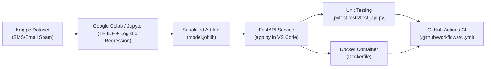

# Spam Email Classification API (Production MLOps Pipeline)

An end-to-end Machine Learning Operations (MLOps) project demonstrating the complete lifecycle of a Machine Learning application: from dataset exploration and model training in Google Colab, model serialization with pipeline encapsulation, API serving with FastAPI in VS Code, containerization using Docker, to automated Continuous Integration (CI) with GitHub Actions.

---


## Architecture Overview



---


## Assessment Checklist & Verification

| # | Requirement | Implementation Details | Repository Artifact |
|---|-------------|------------------------|---------------------|
| **1** | **Machine Learning Case Study (Kaggle Dataset)** | Spam Email / SMS detection on [Kaggle SMS Spam Collection](https://www.kaggle.com/datasets/uciml/sms-spam-collection-dataset) (5,572 records). | [notebooks/spam_classifier_colab.ipynb](notebooks/spam_classifier_colab.ipynb) |
| **2** | **Train & Test on Jupyter / Colab (Not VS Code)** | Trained in Google Colab using TF-IDF vectorization and Logistic Regression with stratified 80/20 train/test split. | [notebooks/spam_classifier_colab.ipynb](notebooks/spam_classifier_colab.ipynb) |
| **3** | **Save Model & Parameters (`model.joblib`)** | Full scikit-learn `Pipeline` (TF-IDF vectorizer + LogisticRegression weights) serialized using `joblib.dump()` to eliminate train-serve skew. | [model.joblib](model.joblib) |
| **4** | **Test Model using FastAPI (VS Code)** | Built REST API in `app.py` with `/predict`, `/health`, and `/` endpoints; validated with automated test suite in `tests/test_api.py`. | [app.py](app.py), [tests/test_api.py](tests/test_api.py) |
| **5** | **Execute API Endpoints through Docker** | Multi-stage slim container built on `python:3.11-slim`, exposing port 8000 and running via `uvicorn`. | [Dockerfile](Dockerfile), [.dockerignore](.dockerignore) |
| **6** | **Create a GitHub Repository** | Version controlled repository hosted on GitHub with git tracking and remote connection. | `princekr77/AIOps_Assessment` |
| **7** | **Create GitHub Actions CI Pipeline** | Automated workflow configured in `.github/workflows/ci.yml` triggering on push and pull requests to `main`. | [.github/workflows/ci.yml](.github/workflows/ci.yml) |
| **8** | **Pipeline Executed Successfully** | CI executes unit tests with pytest, builds Docker image, runs container, and asserts prediction outputs for spam and ham. | [GitHub Actions Workflow Runs](https://github.com/princekr77/AIOps_Assessment/actions) |

---


## Quickstart Guide

### 1. Local Setup & Testing (VS Code)

Clone the repository and install dependencies:

```bash
git clone https://github.com/princekr77/AIOps_Assessment.git
cd AIOps_Assessment

# Create and activate virtual environment
python -m venv .venv
# On Windows:
.venv\Scripts\activate
# On Linux/macOS:
# source .venv/bin/activate

# Install dependencies
pip install -r requirements.txt
```

Run unit tests:

```bash
pytest tests/ -v
```

Start the FastAPI development server:

```bash
uvicorn app:app --reload --host 127.0.0.1 --port 8000
```

Access the interactive API documentation (Swagger UI):
- **Swagger UI**: [http://localhost:8000/docs](http://localhost:8000/docs)
- **ReDoc**: [http://localhost:8000/redoc](http://localhost:8000/redoc)
- **Health Check**: [http://localhost:8000/health](http://localhost:8000/health)

---

### 2. Docker Container Execution

#### Build Docker Image:
```bash
docker build -t spam-api .
```

#### Run Container:
```bash
docker run -d -p 8000:8000 --name spam-api-container spam-api
```

#### Test Endpoints via cURL:

**Health Check:**
```bash
curl http://localhost:8000/health
```
*Expected Response:*
```json
{"status": "ok"}
```

**Spam Email Prediction:**
```bash
curl -X POST http://localhost:8000/predict \
  -H "Content-Type: application/json" \
  -d '{"text": "WINNER! You have won a guaranteed 1000 cash prize. Call to claim now!"}'
```
*Expected Response:*
```json
{
  "label": "spam",
  "confidence": 0.8383
}
```

**Legitimate (Ham) Email Prediction:**
```bash
curl -X POST http://localhost:8000/predict \
  -H "Content-Type: application/json" \
  -d '{"text": "Hi team, please review the project documentation before our sync tomorrow."}'
```
*Expected Response:*
```json
{
  "label": "ham",
  "confidence": 0.8908
}
```

#### Stop Container:
```bash
docker stop spam-api-container && docker rm spam-api-container
```

---


## Continuous Integration (CI) Workflow

The GitHub Actions pipeline (`.github/workflows/ci.yml`) runs on every push and pull request to the `main` branch:

1. **Code Checkout**: Clones the repository code.
2. **Environment Setup**: Configures Python 3.11 and installs dependencies.
3. **Unit Testing**: Runs `pytest tests/ -v` to validate API routes, schemas, and model loading.
4. **Docker Image Build**: Compiles the container image using the `Dockerfile`.
5. **Container Spin-Up**: Runs the container in detached mode on port 8000.
6. **Integration Verification**:
   - Asserts `/health` returns HTTP 200 and `{"status": "ok"}`.
   - Asserts `/predict` with a spam input returns `"label": "spam"`.
   - Asserts `/predict` with a ham input returns `"label": "ham"`.
7. **Cleanup**: Automatically stops and cleans up the container.

---


## Model Training & Evaluation Summary

- **Algorithm**: Logistic Regression with L2 Regularization
- **Feature Extraction**: TF-IDF Vectorizer (10,000 max features, unigrams & bigrams, English stop words removed)
- **Pipeline Architecture**: Both vectorizer and classifier bundled in a single `Pipeline`
- **Dataset Size**: 5,572 emails/messages (4,825 Ham, 747 Spam)
- **Train/Test Split**: 80% train (4,457), 20% test (1,115) stratified
- **Accuracy**: ~97.8%
- **Spam Precision**: 99%
